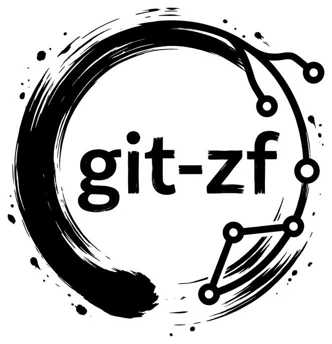

<div align="center">



</div>

git-zf is a git subcommand that carries a piece of work from the issue that
asks for it to the merge that closes it: `git zf issue start`, `git zf
commit`, `git zf review request`, `git zf issue close`. Every step is a
form in the terminal with a flag for every prompt, and everything it records
is stored in the repository itself, under `refs/zf/`. No database, no
server, no account.

## What it is for

Small teams and solo developers who want a git-flow with issues, reviews
and a tidy history, without running a forge or a tracker, or who already
have a tracker and want git to stay in step with it. You can use git-zf as:

- **An issue manager inside the repository.** `git zf issue new` files an
  issue as a chain of commits under `refs/zf/issues/`. Title, description,
  labels and comments travel with `git fetch` and `git push`, so a fresh
  clone sees the whole backlog. See
  [where git-zf keeps its state](./concepts/state-in-the-repository.md).
- **A mirror of your bug tracker.** With Redmine, GitHub, Forgejo or Gitea
  configured, `git zf` lists the tracker's issues, moves them through their
  statuses when you start and close work, and can mirror a project's issues
  with the ones in the repository, both ways, so you can work offline and
  sync later. See [trackers and the mirror](./concepts/trackers-and-the-mirror.md).
- **A branch and commit helper.** A branch is named after its issue,
  `ABC-42@feat@add-oauth-login`, and `git zf commit` composes a
  commitizen-style message pre-filled from that name, with the issue ID in
  the scope or the footer. See [start an issue](./workflows/start-an-issue.md)
  and [commit](./workflows/commit.md).
- **A review tool.** `git zf review request` locks a branch for a peer,
  who answers with `approve` or `reject`. The branch rejects pushes while
  the review is open, the review itself is a chain of commits in the
  repository, and approvals can be required to be signed. See [review a branch](./workflows/review.md).
- **A merge assistant.** `git zf issue close` merges the branch into its
  base with the strategy you pick, rebase, squash or a classic merge, or
  through a pull request merged on the forge, then closes the issue and
  the tracker ticket. See
  [close an issue](./workflows/close-an-issue.md) and
  [merge strategies](./reference/merge-strategies.md).

Each piece works alone. A team with no tracker gets issues, reviews and
merges from git alone; a team on GitHub gets the same flow plus pull
requests and ticket updates.

## Why keep it in the repository

- **Nothing to run.** Clone the repository and `git fetch`: the issues,
  the branches in progress and the open reviews are there.
- **Nothing is lost.** Two people commenting on the same issue offline, or
  two reviewers acting on the same review, both land: the chains merge,
  never overwrite.
- **Plain git underneath.** Every record is a commit you can read with
  `git log` and `git show`. The formats are documented in
  [under the hood](./under-the-hood/issue-refs.md).

## The flow in one picture

```
git zf issue start ABC-42        branch ABC-42@feat@add-oauth-login, ticket → In Progress
git zf commit                    feat(ABC-42): add oauth login
git zf review request            branch locked, a reviewer is asked
git zf review approve            approval recorded in refs/zf/reviews/ABC-42
git zf issue close               merge into main, ticket → Closed, branch marked merged
```

An [issue is not a branch](./concepts/issues-and-branches.md): a branch can
exist without a ticket (`git zf branch new`), while a started issue always
has one.

## Where to go next

1. [Install](getting-started/install.md) the binary and the hooks.
2. [First steps](getting-started/first-steps.md): the menu, a first commit, the configuration.
3. Then the [workflows](./workflows/start-an-issue.md), one page per step.
